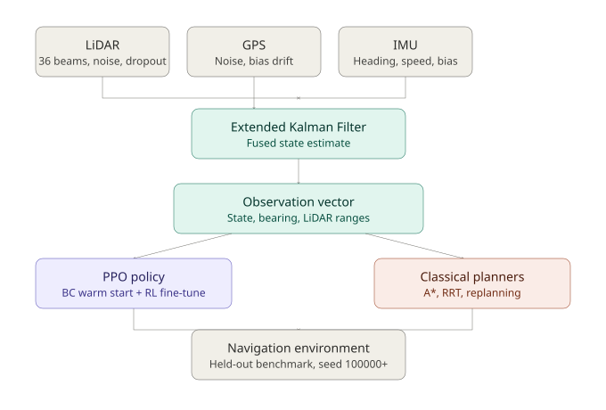
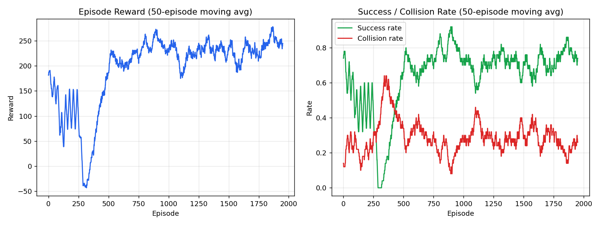

# Fleet Navigation & Sensor Fusion: RL vs. Classical Planning Benchmark

A from-scratch research benchmark comparing a learned navigation policy (PPO, implemented
in raw PyTorch — no RL library dependency) against classical path planners (A*, RRT,
replanning A*) on a continuous-control autonomous navigation task, where the learned
policy operates on **noisy, fused sensor estimates** (simulated LiDAR + GPS + IMU via an
Extended Kalman Filter) rather than privileged ground-truth state.

This repository documents not just the final results but the actual debugging process
that got there — five real, verified bugs (a PPO log-prob mismatch, an EKF angle-wraparound
bug, an unlearnable feature encoding, and two distinct reward-hacking local optima) are
each diagnosed with evidence and fixed in [`docs/module1_results.md`](docs/module1_results.md).
Nothing here is a placeholder; every number in this README comes from a real training run
and a real held-out evaluation.

## Status

| Module | Status | Description |
|---|---|---|
| **1. Fleet navigation + sensor fusion** | ✅ Complete | PPO navigation policy, EKF sensor fusion, A*/RRT baselines, full benchmark |
| **2. Distributed telemetry + cluster fault detection** | 🔜 Planned | Fleet telemetry pipeline feeding a cluster fault-detection model trained on a public trace dataset |
| **3. Integration + MLOps polish** | 🔜 Planned | Shared dashboard, experiment tracking, final repo polish |

This is being built incrementally, with each module held to a "must actually run and
produce real numbers" bar before moving to the next — see [Project Philosophy](#project-philosophy)
below.

## Architecture



## Headline Results (Module 1)

Trained PPO policy vs. classical planning baselines, evaluated on **50 held-out seeds**
never used during training, at full task difficulty (14 static + 4 dynamic obstacles):

| Method | Success Rate | Collision Rate | Timeout Rate | Path Efficiency* |
|---|---|---|---|---|
| **PPO (learned, noisy sensor obs)** | **80%** | 20% | **0%** | 1.07 |
| A* (no replanning) | 84% | 8% | 8% | 1.00 |
| A* (with periodic replanning) | 92% | 8% | 0% | 1.00 |
| RRT | 82% | 14% | 4% | 1.11 |

*Path efficiency = actual path length / straight-line distance (1.00 = optimal).

**The headline finding:** PPO is competitive with classical planners despite a strictly
harder information environment — the classical planners are given the true obstacle
field directly (standard for planning baselines), while PPO only ever observes a noisy
EKF-fused estimate from simulated LiDAR/GPS/IMU. PPO also never times out, while the
search-based planners occasionally fail to find a path within budget.

See [`docs/module1_results.md`](module1_results.md) for the medium-difficulty
table, training curves, full methodology, and the development log of bugs found and fixed.



## Repository Structure

```
.
├── .github/workflows/tests.yml # CI: runs the real test suite on push/PR
├── simulation/
│   ├── env_core.py          # Continuous-dynamics nav environment, curriculum scaling
│   └── sensors.py           # Simulated LiDAR/GPS/IMU + Extended Kalman Filter fusion
├── navigation/
│   ├── classical_planners.py  # A*, RRT, pure-pursuit controller, replanning A*
│   ├── policy_ppo.py           # PPO (actor-critic, GAE, clipped objective) from scratch
│   ├── observation.py          # Builds the policy's observation vector from fused state
│   ├── behavior_cloning.py     # Heuristic-demonstration warm start for PPO
│   ├── train_ppo.py            # Curriculum-scheduled PPO training loop (resumable)
│   └── benchmark.py            # Held-out evaluation harness: PPO vs. A*/RRT
├── tests/                       # 13 real unit/regression tests (all passing)
├── runs/                        # Training history, checkpoints, benchmark JSON, plots
├── docs/
│   ├── module1_results.md      # Full methodology, results tables, bug-fix development log
│   └── architecture.svg        # Data-flow diagram (sensors -> fusion -> policy/planner -> env)
├── requirements.txt
├── CHANGELOG.md
├── CONTRIBUTING.md
├── LICENSE
└── README.md
```

## Quickstart

```bash
git clone https://github.com/Aranya2801/<repo-name>.git
cd <repo-name>
pip install -r requirements.txt
```

**Reproduce the benchmark from the provided checkpoint:**
```bash
python -m navigation.benchmark \
    --ppo_checkpoint runs/ppo_v2/policy_checkpoint.pt \
    --n_episodes 50 --difficulty 1.0 --out runs/benchmark_results.json
```

**Train from scratch:**
```bash
# 1. Behavior-cloning warm start (solves PPO's cold-start exploration problem —
#    see docs/module1_results.md for why this step is necessary, not optional)
python -m navigation.behavior_cloning --demo_episodes 60 --bc_epochs 20 \
    --out runs/ppo_v1/policy_bc_warmstart.pt

# 2. Curriculum-scheduled PPO fine-tuning (resumable across multiple calls)
python -m navigation.train_ppo --episodes 2000 --out runs/ppo_v2 \
    --curriculum_total_episodes 2500 \
    --warmstart_path runs/ppo_v1/policy_bc_warmstart.pt

# Resume an interrupted run:
python -m navigation.train_ppo --episodes 400 --out runs/ppo_v2 \
    --curriculum_total_episodes 2500 --resume
```

**Run the test suite:**
```bash
pip install pytest
python -m pytest tests/ -v
```

## Design Notes

- **No RL library dependency.** PPO (actor-critic network, GAE advantage estimation,
  clipped surrogate objective, running reward normalization) is implemented directly in
  PyTorch rather than via Stable-Baselines3, so the actual update math is inspectable
  and the environment isn't constrained to a particular wrapper API.
- **Fair comparison by design.** The RL policy never sees ground-truth obstacle
  positions or true vehicle state — only a noisy EKF-fused estimate from simulated
  LiDAR/GPS/IMU. Classical planners get true obstacle positions (standard for planning
  baselines) but not privileged future information.
- **Curriculum learning, not luck.** Direct diagnosis showed that pure PPO exploration
  on the full-difficulty task essentially never samples a successful episode (0/40 in
  one test), even though a trivial heuristic solves it 95% of the time — so there's
  nothing for policy-gradient updates to reinforce. Behavior-cloning warm start +
  difficulty curriculum solves this; see the development log for the full diagnosis.

## Project Philosophy

This repository intentionally does not claim a 15-technology, every-box-checked scope.
An earlier draft of this project's spec called for autonomous driving + Hadoop/Spark/Kafka
big-data monitoring + a generative AI copilot + Kubernetes/Helm deployment + digital twin
simulation, all in one shot. Building that as actual, working, verified code in one pass
isn't realistic — and shipping it as decorative stub files would be worse than not shipping
it, especially for code meant to be read by an interviewer, professor, or collaborator.

Instead, each module here is built to a simple bar: **it must actually run, and the
numbers it reports must be real.** Module 1 took substantially more debugging than
originally planned (see the development log) precisely because surfacing and fixing real
bugs — rather than producing code that merely looks plausible — was treated as the point.

## Changelog

See [CHANGELOG.md](CHANGELOG.md) for a detailed module-by-module history, including
every bug found and fixed during development.

## Author

**Aranya Ghosh** — AI/ML Research Engineer, research
experience at IIIT Nagpur and IIT Kharagpur, BTech IT from KIIT University.

- GitHub: [@Aranya2801](https://github.com/Aranya2801)

## License

MIT — see [LICENSE](LICENSE).
