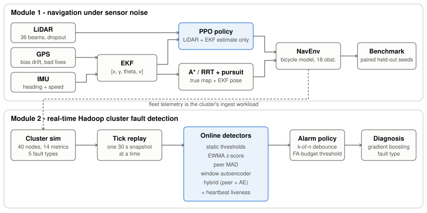
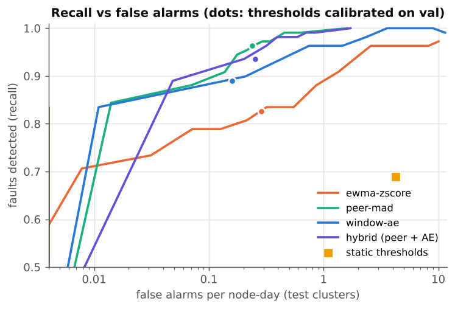

# Autonomous Fleet Navigation + Real-Time Hadoop Cluster Fault Detection

[](https://github.com/Aranya2801/AI-Powered-Navigation-for-Autonomous-Vehicles-Real-Time-Hadoop-Cluster-Fault-Detection/actions/workflows/tests.yml)

This project covers two parts of running an autonomous vehicle fleet:

1. **Navigation under sensor noise.** I trained a PPO policy that drives through
   static and moving obstacles using only simulated LiDAR and a GPS/IMU estimate fused
   by an Extended Kalman Filter. It never sees the true pose or the true map. I compared
   it with A\*, A\* with replanning and RRT. Those planners get the true obstacle map.
2. **Real-time fault detection for the Hadoop cluster that ingests the fleet's
   telemetry.** Per-node metrics stream in every 30 s. Online detectors raise alarms,
   and a classifier names the fault type: failing disk, JVM memory leak, network
   problem, runaway CPU or node crash.

Everything is plain Python, NumPy and PyTorch. PPO, the EKF and the planners are
written from scratch. All numbers below come from the JSON files in `runs/`, and
`scripts/` contains the commands that produce them.



## Results

### Navigation: 200 held-out episodes, full difficulty (14 static + 4 moving obstacles)

| Method | Success | Collision (static / moving) | Timeout | Path efficiency | ms / step |
|---|---|---|---|---|---|
| **PPO (ours)**, sensors only | **81.0%** ± 4.1% (3 seeds) | 18.0% (10.5% / 7.0%) | 1.0% | 1.14 | 0.36 |
| A\*, true map | 68.5% [62%, 75%] | 31.5% (6.0% / 25.0%) | 0.0% | 1.07 | 0.05 |
| A\* + replanning every 2 s, true map | 82.0% [76%, 87%] | 18.0% (1.5% / 16.5%) | 0.0% | 1.08 | 0.54 |
| RRT, true map | 68.0% [61%, 74%] | 32.0% (7.0% / 24.0%) | 0.0% | 1.15 | 0.05 |

Brackets are 95% Wilson intervals. Every method runs on the same 200 seeds with the same
sensor-noise sequence, so the comparisons are paired. With McNemar's test, two
of the three PPO seeds beat one-shot A\* and RRT at p < 0.01. The third seed is ahead
too, but only at p ≈ 0.07–0.08. No seed differs significantly from A\* with replanning
(p ≥ 0.22), so the two are effectively tied at standard noise.

**The main finding comes from degrading the sensors.** In the stress test below, every
noise magnitude (GPS, IMU, LiDAR) is multiplied by k. A\* with replanning drops from 82% to
51% at 4x noise. The PPO policy stays at 78–82%:

| Method | 0.5x | 1x | 2x | 3x | 4x |
|---|---|---|---|---|---|
| PPO (mean of 3 seeds) | 81% | 81% | 82% | 80% | 78% |
| A\* + replanning | 81% | 82% | 78% | 64% | 51% |
| A\* | 71% | 68% | 60% | 44% | 38% |
| RRT | 69% | 68% | 58% | 54% | 48% |


Here is why. The planners turn a map path into steering commands through the
*absolute* pose estimate, so GPS error moves the whole plan relative to the real
obstacles. The policy steers mostly from body-frame LiDAR and the relative goal bearing,
and those barely depend on absolute position. Most of the planners' extra failures are
static-obstacle hits: at 4x noise the replanning A\* static-collision rate goes from
1.5% to 38%.

### Cluster fault detection: 8 held-out simulated clusters, 40 nodes x 2 days, 109 faults

Each detector's threshold is calibrated on separate validation clusters to stay within
0.25 false alarms per node-day, then frozen.

| Detector | Recall | False alarms / node-day | Median delay | ms / tick (40 nodes) |
|---|---|---|---|---|
| Static thresholds (Ambari-style) | 68.8% | 4.27 | 14.0 min | 0.02 |
| EWMA z-score (own history) | 82.6% | 0.29 | 7.8 min | 0.05 |
| **Peer MAD** (vs. other nodes) | **96.3%** | 0.24 | 12.0 min | 0.42 |
| Window autoencoder | 89.0% | **0.16** | 9.0 min | 0.85 |
| Hybrid (peer + AE) | 93.6% | 0.25 | 10.0 min | 1.33 |

Fault-type diagnosis on the faults caught by peer MAD is 93% accurate (98/105). The only
mistakes are CPU faults read as memory leaks. 132 of peer MAD's 153 false alarms land on
benign *data-skew hot spots*, where one node legitimately gets more work. The
autoencoder, which also models each node's own history, raised none on hot spots.
[docs/results.md](docs/results.md#module-2-cluster-fault-detection) covers this in more
detail.



## Repository layout

```
simulation/
  env_core.py            continuous 2D world, bicycle model, curriculum, reward
  sensors.py             LiDAR ray casting, GPS (bias drift, bad fixes), IMU, EKF
navigation/
  observation.py         policy input, built from sensor data only
  policy_ppo.py          PPO: actor-critic, GAE, clipping, obs/reward normalisation
  behavior_cloning.py    optional warm start from an A* teacher (DART noise)
  train_ppo.py           curriculum training loop, resumable
  classical_planners.py  grid A*, RRT, pure pursuit, replanning
  benchmark.py           paired held-out evaluation, Wilson CIs, McNemar tests
cluster/
  simulator.py           Hadoop cluster telemetry + fault injection
  detectors.py           static / EWMA / peer MAD / window AE / hybrid, alarm policy
  diagnosis.py           fault-type classifier (gradient boosting)
  evaluate.py            calibration on val, event-level metrics on test
scripts/
  train_all.sh           every navigation training run used in the docs
  run_benchmarks.sh      every navigation evaluation used in the docs
  make_figures.py        docs/figures/*.png from runs/*.json
  results_tables.py      the markdown tables above, printed from runs/*.json
runs/                    checkpoints, training histories, benchmark + cluster results
tests/                   45 unit / regression tests
docs/results.md          methods, full tables, ablations, development notes
```

## Quickstart

```bash
git clone https://github.com/Aranya2801/AI-Powered-Navigation-for-Autonomous-Vehicles-Real-Time-Hadoop-Cluster-Fault-Detection.git
cd AI-Powered-Navigation-for-Autonomous-Vehicles-Real-Time-Hadoop-Cluster-Fault-Detection
pip install -r requirements.txt
python -m pytest -q
```

Evaluate the committed checkpoint against the planners (about a minute on a laptop CPU):

```bash
python -m navigation.benchmark \
    --ppo_checkpoint "PPO=runs/ppo_s0/policy_checkpoint.pt" \
    --n_episodes 200 --difficulty 1.0 --out runs/my_benchmark.json
```

Train a policy (10–20 min on one CPU core):

```bash
python -m navigation.train_ppo --episodes 8000 --curriculum_total_episodes 8000 \
    --ramp_frac 0.5 --lr_anneal --seed 0 --out runs/ppo_s0
```

Run the cluster experiment (simulate, train, calibrate, evaluate; about 7 min):

```bash
python -m cluster.evaluate --out runs/cluster
```

Reproduce everything: `scripts/train_all.sh`, `scripts/run_benchmarks.sh`,
`python -m cluster.evaluate`, then `python scripts/make_figures.py`.

## Design choices

- **The policy never sees ground truth.** `ObservationBuilder` only reads the sensor
  measurement and the goal coordinates. `tests/test_ppo.py` checks that changing
  `env.state` doesn't change the observation.
- **Baselines get the true map but the same localisation.** The planners track their
  path with the EKF pose, so the comparison is about perceiving obstacles, not about
  localisation. Their inflation margins were tuned on a separate seed range
  (5000–5059), not on the test seeds.
- **Three disjoint seed ranges**: training episodes (0–7999), BC demos (200000+) and
  evaluation (100000–100199).
- **Detectors are compared at the same alarm logic and false-alarm budget.**
  Every detector goes through the same k-of-n debounce. Each threshold is picked on
  validation clusters, and the operating curves in `docs/figures` show the full
  recall/false-alarm trade-off.

## Limitations

- Both environments are simulated. The navigation world is 2D with circular
  obstacles and a kinematic vehicle. The cluster simulator is modelled on Hadoop JMX
  metrics, but its faults are injected by rules I wrote. I couldn't find public traces
  with node-level hardware/JVM fault labels, which is what measuring detection delay
  needs. The cluster numbers show how the methods *compare*. They are not a prediction
  of performance on a real cluster.
- The robustness result has a limit: the policy was trained at 1x noise and happens to
  depend on the parts of the observation that noise scaling hurts least. Noise models
  that corrupt LiDAR more heavily (rain, reflective surfaces) are not covered.
- PPO still collides in about 18% of full-difficulty episodes, more often with static
  obstacles (10.5%) than moving ones (7.0%). It also varies across seeds (76.5–84.5%),
  so three seeds is the minimum I'd want before trusting a comparison.
- Memory leaks are found late (median about 70 min) by every detector. That reflects how
  slowly they ramp up in the simulator. A trend test on the post-GC heap floor would
  likely do better, and I haven't added one yet.

## Author

**Aranya Ghosh** · [aranyaghosh.org](https://aranyaghosh.org) · [@Aranya2801](https://github.com/Aranya2801)

MIT licensed, see [LICENSE](LICENSE).
