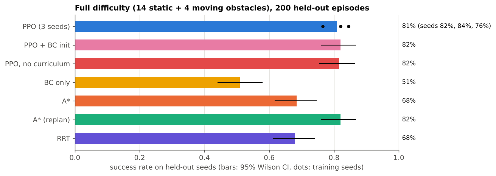
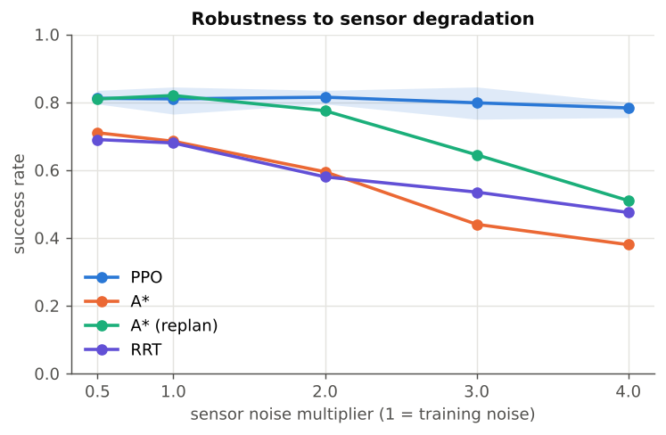
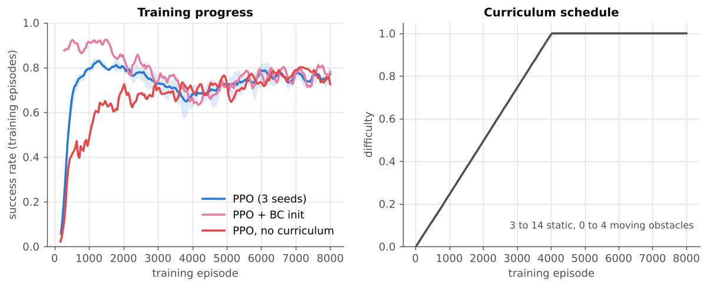
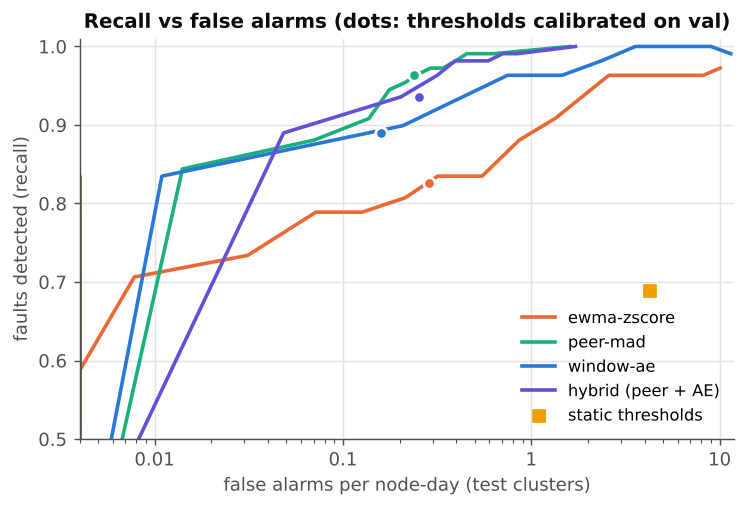
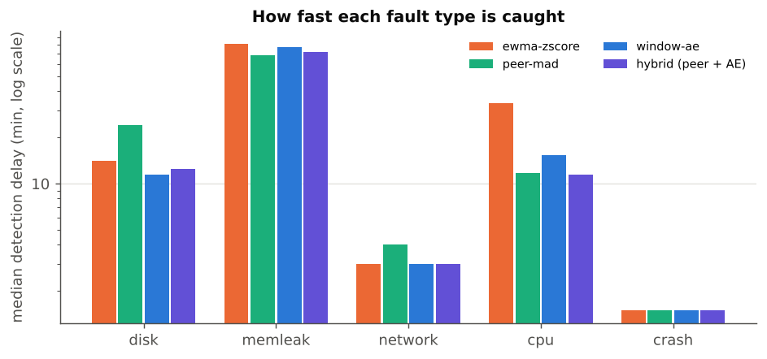
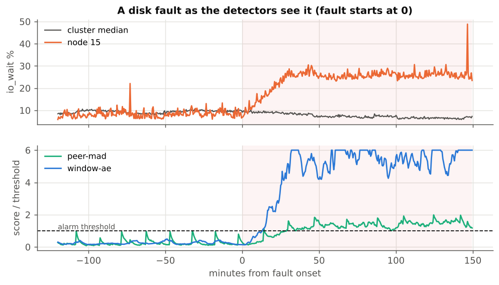

# Methods and results

Every number here is printed by `scripts/results_tables.py` from the JSON files in
`runs/`. If you re-run the scripts and get different numbers, the JSON files are the
source of truth, not this page.

- [Module 1: navigation](#module-1-navigation)
- [Module 2: cluster fault detection](#module-2-cluster-fault-detection)
- [Development notes](#development-notes)

---

## Module 1: navigation

### Environment (`simulation/env_core.py`)

- 64 x 64 world. The vehicle is a kinematic bicycle (wheelbase 2, radius 0.8, max speed
  4, dt 0.2 s). Actions are `[accel, steer]` in [-1, 1].
- Circular obstacles. Half of the static ones are placed near the start-goal line,
  otherwise driving straight at the goal solves most episodes. Moving obstacles travel
  at 0.8–2.0 units/s and bounce off the walls. Leaving the world counts as a collision.
- Difficulty d ∈ [0, 1] sets 3→14 static obstacles, 0→4 moving obstacles, 150→400 max
  steps and 35→57 start-goal distance. The start-goal distance is exact. A test
  checks it, because an earlier version of the sampler undershot it.
- Reward: progress towards the goal (1.0 per unit), -0.01 per step, +20 for reaching
  the goal, -20 for a collision. There is also a small proximity penalty below 2 units
  of clearance, capped at 0.05 per step. Finally, an idle penalty grows with every
  consecutive step below 0.3 speed, which stops the policy from learning to park.

### Sensors and fusion (`simulation/sensors.py`)

| Sensor | Model |
|---|---|
| LiDAR | 36 beams, 15 m range, σ = 0.1 range noise, 3% dropout (returns max range) |
| GPS | σ = 0.6, random-walk bias (σ 0.02/step, clipped at ±1.0), 2% degraded fixes with σ = 4.0, flagged by the receiver |
| IMU | heading σ = 0.03 + fixed per-episode bias up to ±0.02; speed σ = 0.08 |

The EKF state is `[x, y, θ, v]`. Prediction uses the bicycle model with the applied
controls and an analytic Jacobian. Updates use GPS position and IMU heading/speed. The
heading innovation is wrapped to (-π, π], the covariance update uses the Joseph form, and
GPS fixes are gated with χ²(2) at 99.9%. With the default noise, the mean position
error is about 0.2 units.

### Policy (`navigation/policy_ppo.py`, `navigation/observation.py`)

The observation has 78 dimensions: goal distance, sin/cos of the goal bearing relative to the
*estimated* heading, estimated speed, previous action, 36 LiDAR ranges, and the change
in each range since the last step. The change gives a rough cue for moving obstacles.

PPO uses separate 2x128 tanh actor and critic networks and a state-independent log-std. Other
settings: GAE λ = 0.95, γ = 0.99, clip 0.2 (policy and value), 8 epochs on 4096-step
rollouts with minibatch 512, early stop at KL 0.03, running observation normalisation,
reward scaling by the running std of the return, lr 3e-4 decayed linearly to 3e-5, and
bootstrapped time-limit truncation. The raw Gaussian sample is stored and used
for log-probs, and clipping happens only at the env boundary.

Training ran for 8000 episodes (about 0.66–0.79M steps). Difficulty ramps linearly 0→1 over the first
4000 episodes. Each run took 11–19 min on a single CPU thread.

### Baselines (`navigation/classical_planners.py`)

- **A\***: an 8-connected grid at 0.5 resolution. Obstacles are inflated by radius +
  vehicle radius + 1.0, or + 1.5 for moving obstacles at their snapshot position. The path
  is then smoothed by line-of-sight shortcutting.
- **RRT**: step 1.5, 10% goal bias, up to 6000 iterations, same inflation and smoothing.
- **Tracking**: pure pursuit (lookahead 2.5, cruise speed 3.0, slower on sharp turns)
  on the EKF pose.
- **A\* (replan)** replans every 10 steps (2 s) against the current obstacle positions.

All planners get the true obstacle map. The margins were tuned on seeds 5000–5059.

### Protocol

- Test seeds 100000–100199, disjoint from training (0–7999) and from BC demos
  (200000+).
- A seed fixes the layout *and* the sensor noise sequence, so every method faces exactly
  the same episodes. That pairing is what makes McNemar's test valid here.
- The PPO action is the deterministic mean of the policy.
- Path efficiency is path length divided by straight-line distance, over successful
  episodes only.

### Full difficulty

| Method | Success | Collision (static / moving) | Timeout | Path efficiency | ms / step |
|---|---|---|---|---|---|
| PPO (ours) | **81.0%** ± 4.1% (3 seeds) | 18.0% (10.5% / 7.0%) | 1.0% | 1.14 | 0.36 |
| PPO + BC init | 82.0% [76%, 87%] | 18.0% (6.5% / 11.5%) | 0.0% | 1.12 | 0.41 |
| PPO, no curriculum | 81.5% [76%, 86%] | 14.5% (10.0% / 4.5%) | 4.0% | 1.22 | 0.34 |
| BC only | 51.0% [44%, 58%] | 49.0% (37.5% / 11.5%) | 0.0% | 1.06 | 0.39 |
| A* | 68.5% [62%, 75%] | 31.5% (6.0% / 25.0%) | 0.0% | 1.07 | 0.05 |
| A* (replan) | 82.0% [76%, 87%] | 18.0% (1.5% / 16.5%) | 0.0% | 1.08 | 0.54 |
| RRT | 68.0% [61%, 74%] | 32.0% (7.0% / 24.0%) | 0.0% | 1.15 | 0.05 |

PPO seeds individually: 82.0%, 84.5%, 76.5%. McNemar results per seed:

| | vs A\* | vs A\* (replan) | vs RRT |
|---|---|---|---|
| seed 0 | p = 0.003 | p = 1.0 | p = 0.002 |
| seed 1 | p = 0.0005 | p = 0.57 | p = 0.0001 |
| seed 2 | p = 0.08 | p = 0.22 | p = 0.07 |

### Medium difficulty (d = 0.5)

| Method | Success | Collision (static / moving) | Timeout | Path efficiency | ms / step |
|---|---|---|---|---|---|
| PPO (ours) | **93.3%** ± 1.2% (3 seeds) | 5.5% (3.3% / 1.8%) | 1.2% | 1.10 | 0.36 |
| PPO + BC init | 92.0% [87%, 95%] | 8.0% (1.0% / 6.5%) | 0.0% | 1.09 | 0.38 |
| PPO, no curriculum | 88.5% [83%, 92%] | 9.5% (4.5% / 5.0%) | 2.0% | 1.14 | 0.35 |
| BC only | 73.0% [66%, 79%] | 27.0% (19.5% / 7.0%) | 0.0% | 1.02 | 0.35 |
| A* | 85.5% [80%, 90%] | 14.5% (3.5% / 11.0%) | 0.0% | 1.04 | 0.05 |
| A* (replan) | 92.5% [88%, 95%] | 7.5% (1.5% / 6.0%) | 0.0% | 1.03 | 0.29 |
| RRT | 83.5% [78%, 88%] | 16.5% (3.5% / 12.0%) | 0.0% | 1.13 | 0.04 |

### What the numbers say

**Planners fail on moving obstacles, PPO fails on static ones.** One-shot A\* and RRT
lose about 25 points to moving obstacles because they plan against a snapshot.
Replanning every 2 s fixes part of that (25% → 16.5%). PPO's moving-obstacle collision rate
(7%) is less than half of replanning A\*'s. Its remaining failures are mostly static obstacles,
which a planner with the true map hardly ever hits (1.5%).

**PPO takes longer routes** (1.14 vs 1.07–1.08). It reacts to what the LiDAR shows
instead of planning against a known map.

**Sensor-noise stress test** (`runs/noise/`, 200 episodes per point, PPO averaged over 3
seeds):

| Method | 0.5x | 1x | 2x | 3x | 4x |
|---|---|---|---|---|---|
| PPO | 81% | 81% | 82% | 80% | 78% |
| A* | 71% | 68% | 60% | 44% | 38% |
| A* (replan) | 81% | 82% | 78% | 64% | 51% |
| RRT | 69% | 68% | 58% | 54% | 48% |

The planners' path lives in world coordinates and is followed through the absolute
pose estimate. As GPS bias and noise grow, the vehicle drives where the EKF *thinks*
the free corridor is. You can see this in the collision split: the replanning A\* static-collision
rate goes 1.5% → 6% → 21% → 38% from 1x to 4x. The policy steers from body-frame LiDAR,
which only gets 4x a small σ (0.4 units), and from the relative bearing to the goal, which
changes little when the absolute pose error is a few units at 30+ units of distance.
This is a property of these sensor models more than a general law: a noise model
that hurts LiDAR harder would change the picture.

### Ablations (one seed each, so read them as indications)

- **Behaviour-cloning warm start** (`--warmstart_path`). The teacher is replanning A\* (90%
  success on the demo seeds), with DART noise in half the episodes. 97k samples; the best
  epoch reached a held-out R² of 0.62. BC alone gets 51%: the teacher acts on a map the
  student can't see, so a lot of what it does isn't predictable from the observation.
  As a PPO initialisation it speeds up the start (the 5-update success average first
  reaches 70% at episode 281 vs 510) but ends in the same place (82.0% vs 81.0 ± 4.1%).
- **No curriculum** (full difficulty from episode 0). Learns more slowly: it first
  reaches 70% at episode 1996. It ends at a similar full-difficulty success (81.5%), but with
  more timeouts (4%), longer paths (1.22) and 88.5% at medium difficulty vs 93.3%.
  In this environment the curriculum mostly buys sample efficiency and cleaner
  driving.

The dip around episode 4000 is the curriculum reaching full difficulty. The success
rate in that plot is on stochastic training episodes, so it sits below the
deterministic evaluation numbers.

---

## Module 2: cluster fault detection

### Simulator (`cluster/simulator.py`)

A 40-node cluster reports 14 metrics every 30 s, modelled on DataNode/NodeManager
JMX and node exporters: CPU, memory, JVM heap, GC pause, io_wait, disk read/write,
network in/out, TCP retransmits, NameNode heartbeat latency, running containers, failed
block ops and task failures.

The workload is shared across nodes: a daily cycle (fleet telemetry ingest), a 90-minute
nightly ETL that pushes most nodes towards 100% CPU, and Poisson-arriving jobs on random
node subsets that end in a shuffle phase. Benign but alarming-looking events are included
on purpose:

- full-GC spikes
- disk compaction bursts
- NameNode GC pauses that slow every node's heartbeat at once
- data-skew hot spots, where one node gets a large extra share of the load for 0.5–3 h

| Fault | What changes | Duration |
|---|---|---|
| disk | io_wait up to +35%, throughput down to -60%, failed block ops, slower heartbeats | 1–3 h |
| memleak | post-GC heap floor creeps up, GC pauses grow quadratically, task failures; OOM kill + restart if severe | 1.5–4 h, ramps the whole time |
| network | heartbeat up to +120 ms, retransmits up to +4%, throughput down, task failures | 0.5–2 h |
| cpu | CPU pinned at 75–98% regardless of load, slower GC | 0.5–2 h |
| crash | no reports at all | 0.3–2 h |

Each fault ramps in, and its peak severity is drawn from [0.25, 1.0], so many faults
stay mild.

### Detectors (`cluster/detectors.py`)

All detectors are online and see one tick at a time. All of them treat two missing
reports in a row as a heartbeat timeout. They share one alarm policy: fire after 3
consecutive ticks above threshold, clear after 10 below.

| Detector | Idea |
|---|---|
| static thresholds | fixed limits per metric (CPU 95%, io_wait 30%, heartbeat 100 ms, ...), alarm if any is breached |
| EWMA z-score | each node against its own slow EWMA mean/variance, one-sided, frozen while anomalous |
| peer MAD | each node against the cluster median at the same tick (robust z), plus throughput drops |
| window AE | MLP autoencoder on 10-tick windows of peer-z and own-history features, trained on normal windows only |
| hybrid | max of peer MAD and AE, each divided by its own calibrated threshold |

### Protocol

- Separate simulated clusters: train seeds 0–7 (AE + classifier), validation 100–103
  (thresholds), test 1000–1007 (reported). Each cluster has 40 nodes and runs for 2
  days. The test clusters contain 109 faults.
- The threshold is the lowest one that keeps validation false alarms at ≤ 0.25 per
  node-day. Static thresholds keep their fixed limits.
- A fault counts as **detected** if an alarm starts on the right node between onset and
  end + 5 min. **Delay** is measured from onset. Any alarm outside a fault window is a
  **false alarm**.

### Results

| Detector | Recall | FA / node-day | Precision | Median delay | p90 delay | ms / tick (40 nodes) |
|---|---|---|---|---|---|---|
| static-threshold | 68.8% | 4.27 | 3% | 14.0 min | 73 min | 0.02 |
| ewma-zscore | 82.6% | 0.29 | 42% | 7.8 min | 73 min | 0.05 |
| peer-mad | **96.3%** | 0.24 | 52% | 12.0 min | 81 min | 0.42 |
| window-ae | 89.0% | **0.16** | **57%** | 9.0 min | 70 min | 0.85 |
| hybrid (peer + AE) | 93.6% | 0.25 | 45% | 10.0 min | 71 min | 1.33 |

Recall and median delay by fault type:

| Detector | disk | memleak | network | cpu | crash |
|---|---|---|---|---|---|
| static-threshold | 72% (25 min) | 61% (142 min) | 89% (12 min) | 37% (32 min) | 95% (2 min) |
| ewma-zscore | 100% (14 min) | 67% (81 min) | 100% (3 min) | 52% (33 min) | 100% (2 min) |
| peer-mad | 96% (24 min) | 100% (69 min) | 100% (4 min) | 89% (12 min) | 100% (2 min) |
| window-ae | 100% (12 min) | 83% (77 min) | 100% (3 min) | 67% (15 min) | 100% (2 min) |
| hybrid (peer + AE) | 100% (12 min) | 100% (72 min) | 100% (3 min) | 74% (12 min) | 100% (2 min) |

Observations:

- **Static thresholds don't work on a busy cluster.** The nightly ETL legitimately
  pushes CPU to 100%, which produces 4.3 false alarms per node-day. Alarm fatigue also
  costs recall: the one crash they missed (cluster 1001, node 21) happened while that node's
  CPU alarm was already active, so no new alarm started.
- **Peer comparison has the best recall** because cluster-wide load swings cancel out
  in the median. But 132 of its 153 false alarms land on data-skew hot spots: a node
  doing more work than its peers looks exactly like a CPU problem to it.
- **The autoencoder raised no false alarms on hot spots.** It also sees the node's own
  history. My best guess is that on a hot spot every load-related metric rises together,
  and normal operation already contains that pattern. It catches fewer slow CPU and memory faults, though.
- **The hybrid** gets back most of peer MAD's recall, but it also inherits its hot-spot
  false alarms (88). It doesn't beat the better of its two parts here. A gating rule
  ("peer anomaly *and* not explained by load") would be the next thing to try.
- At equal false-alarm rates (the curves above), peer MAD and the AE are close below about
  0.1 FA/node-day. Above that, peer MAD keeps more recall.
- Every method is far within real-time budget: under 1.5 ms per 30-s tick for 40 nodes.

### Diagnosis (`cluster/diagnosis.py`)

The classifier is gradient boosting on mean/max/min of the features over the last 10
ticks, plus the fraction of missing reports. It runs 5 ticks after the alarm, on every
fault peer MAD caught: **93% accuracy (98/105)**.

| true \ predicted | disk | memleak | network | cpu | crash |
|---|---|---|---|---|---|
| disk | 24 | 0 | 0 | 0 | 0 |
| memleak | 0 | 18 | 0 | 0 | 0 |
| network | 0 | 0 | 19 | 0 | 0 |
| cpu | 0 | 7 | 0 | 17 | 0 |
| crash | 0 | 0 | 0 | 0 | 20 |

All errors are CPU faults labelled as memory leaks. Both raise GC pause times, and a
starved JVM collects slowly. Right after the alarm that is the most visible symptom.

### Honest caveats

The simulator encodes my assumptions about how these faults look, and the detectors
were developed against it. The fault effects are additive and fairly clean. Real faults
overlap, and real clusters change hardware and configuration over time. Use these
results to compare *approaches* (thresholds vs own-history vs peers vs learned), not
as an estimate for production.

---

## Development notes

Things that went wrong or surprised me while building this, roughly in order.

1. **Behaviour-cloning validation leaked.** A random 10% sample split gave a nice
   validation curve, but neighbouring steps of one episode are almost identical. With
   the last 10% of episodes held out instead, overfitting starts around epoch 15, so the
   best epoch is restored now.
2. **Planner static collisions came from localisation, not planning.** With a 0.6
   inflation margin, plain A\* hit static obstacles in 16 of 60 tuning episodes. GPS bias
   (up to ±1 unit) was walking the vehicle into obstacles while it tracked a correct path.
   A 1.0 margin, tuned on seeds 5000–5059, fixed most of it.
3. **I expected BC to be necessary, and it wasn't.** The curriculum alone gets PPO off
   the ground, and the BC-initialised run finishes level with the others. BC still
   halves the time to reach 70% training success.
4. **The benchmark ran 150x slower while training was running.** That was 47 ms per step
   instead of 0.3. PyTorch's default intra-op threads were fighting the training
   processes for 2 cores over batch-of-one forward passes. `torch.set_num_threads(1)`
   in both scripts fixed it.
5. **The first cluster simulator was too easy.** Every detector got about 100% recall and
   the classifier got 100%, which mostly showed that the faults were cartoonish. Random
   peak severity and benign hot spots made the comparison meaningful. In the same pass I found
   the job arrival rate was 4x too high: the average node was at 90% CPU all day.
